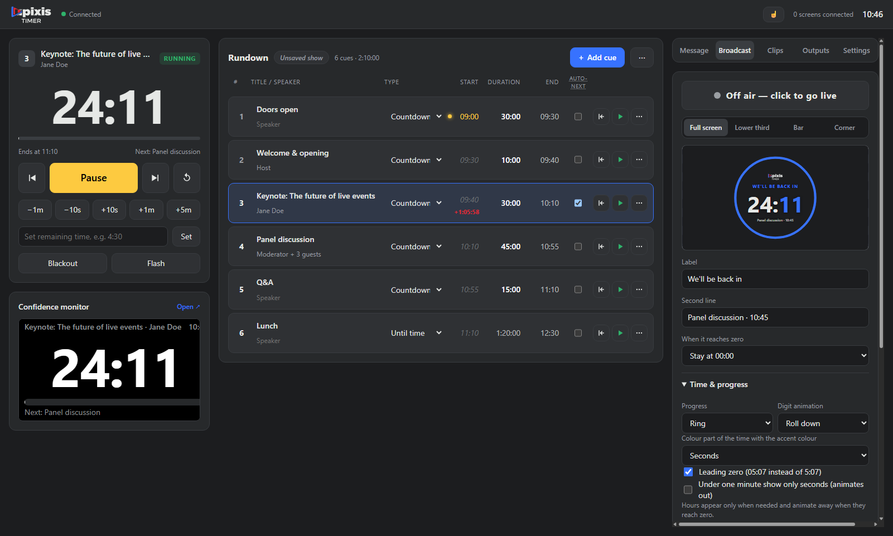
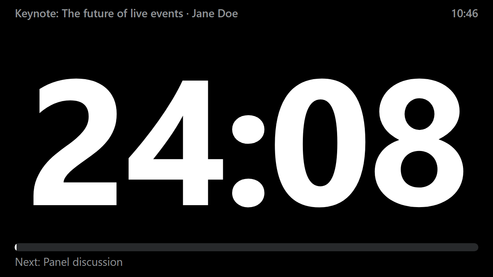
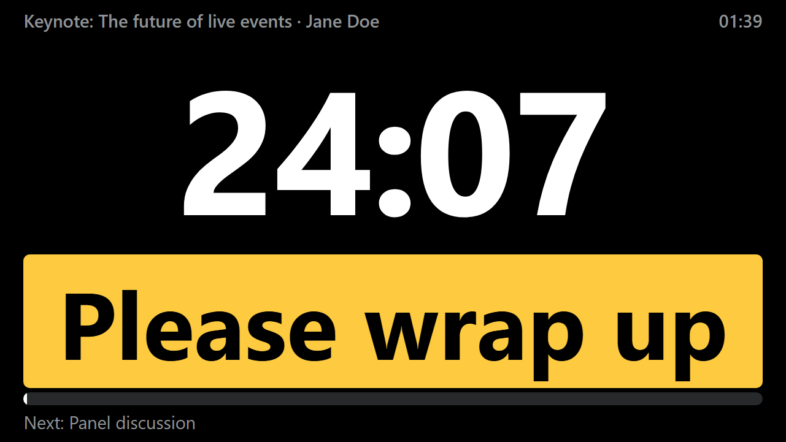
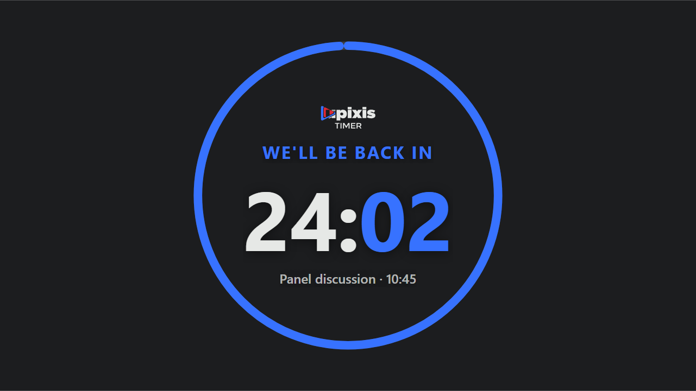
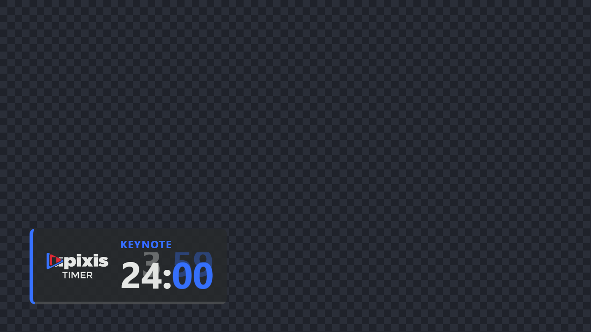
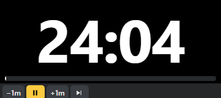

<p align="center">
  
</p>

<p align="center">
  <b>A show timer for live events and broadcast.</b><br>
  Confidence monitors, a floating timer for presenter view, branded on-air countdowns<br>
  and Stream Deck control. It runs on the local network, with no internet or account needed.
</p>

<p align="center">
  
</p>

---

## Contents

- [Features](#features)
- [Install](#install)
- [Quick start](#quick-start)
- [Quitting and reopening](#quitting-and-reopening)
- [Production setups](#production-setups)
- [The rundown](#the-rundown)
- [Confidence monitor & floating timer](#confidence-monitor--floating-timer)
- [Broadcast graphics (OBS, vMix, LED walls)](#broadcast-graphics-obs-vmix-led-walls)
- [Clip timers (QLab, CasparCG)](#clip-timers-qlab-casparcg)
- [Bitfocus Companion / Stream Deck](#bitfocus-companion--stream-deck)
- [Hotkeys](#hotkeys)
- [HTTP API](#http-api)
- [Translations](#translations)
- [Building from source](#building-from-source)

---

## Features

| | |
|---|---|
| **Confidence monitor** | Maximum-size digits that go white → yellow → red → overtime, with a thick progress bar, speaker messages, the next cue and the time of day. When nothing is running it can show a clock and the date. |
| **Floating timer** | A small always-on-top window that stays above PowerPoint's presenter view and fullscreen slideshows. It has its own display options and an optional control bar (−1m, start/pause, +1m, next, minimise, close). |
| **Screen takeover** | Fills a second screen with the timer automatically when the app starts or the screen is plugged in, like a dedicated timer box. |
| **Broadcast graphics** | Full-screen countdown, lower third, bar or corner bug. You set the fonts, colours and logo, choose a bar or ring progress indicator, and pick the digit animation. You can colour just the minutes or seconds and drop the leading zero, and hours and minutes animate away when no longer needed. The background is transparent for OBS and vMix. |
| **Rundown** | Countdown, count-up and "until a time of day" cues. A cue with a **start time** starts itself on schedule, and end times are worked out automatically. Auto-next, drag-to-reorder, import from Excel or Google Sheets, show files and a CSV show report. |
| **Messages** | Send text to the speaker in five colours, with optional flashing and one-tap quick messages. |
| **Clip timers** | Shows the time left on videos playing in **QLab** or **CasparCG**, filtered by cue colour, a tag or the layer. |
| **Multi-laptop** | Timers find each other on the network. Any laptop can follow and control a main timer, with its own floating window and outputs. |
| **Companion** | A full Bitfocus Companion module: actions, colour feedbacks, live variables and ready-made Stream Deck buttons. |
| **Touch mode** | Bigger controls for touchscreen all-in-ones and tablets. It switches on automatically on touch devices. |
| **Everywhere** | A desktop app for Windows (macOS can be built from source), plus every view works in any browser on the network, including phones, tablets and smart TVs. |

<p align="center">
  
  <br>
  
  <br>
  
</p>

---

## Install

**Windows:** download from the [Releases](../../releases) page:

- `Lupixis Timer Setup x.y.z.exe`: the installer (Start-menu shortcut, uninstaller).
- `Lupixis Timer x.y.z.exe`: the portable version, which runs straight from a USB stick with nothing to install.

The builds are not code-signed yet, so Windows SmartScreen may say *"Windows protected your PC"*. Click **More info → Run anyway**.

On first start, Windows Firewall asks about network access. Allow it on **private networks** so phones, other laptops, OBS/vMix and Companion can connect.

**macOS:** see [Building from source](#building-from-source). Mac builds must be made on a Mac.

---

## Quick start

1. Start **Lupixis Timer**. The controller opens.
2. Click **+ Add cue** and give it a title and a duration (`5` = 5 minutes, `4:30`, `1:15:00`), or paste a list from a spreadsheet (**⋯ → Import from spreadsheet**).
3. Choose where the timer appears:
   - **Same laptop as the presentation:** go to **Outputs → Open floating timer** and drag it over the presenter view.
   - **Second screen:** click **Timer on screen 2** in the top bar.
   - **Any other device:** open **Outputs → Links** and scan the QR code.
4. Press **Start** (or Space).

---

## Quitting and reopening

Quitting stops the timer. If the show has unsaved changes, you're asked whether to save them. Next time the app opens with the last saved show, ready but not running (or empty if it was never saved). Only after a crash or power loss does it resume exactly where it was, running timer included. A laptop that is *following* another timer never stops the main timer when it quits.

## Production setups

| Setup | How |
|---|---|
| **One laptop, presenter view + confidence monitor** | Floating timer over PowerPoint's presenter view. The floating timer never takes focus, even when you click its buttons, so presentation clickers keep working. Its hide button (or Ctrl+Alt+T) hides it, and the same hotkey brings it back. Global hotkeys work while PowerPoint has focus. |
| **Dedicated timer laptop / all-in-one PC** | Under **Outputs → When a second screen is connected, fill it with**, choose *Confidence monitor*. Every time the app starts or the HDMI cable goes in, the second screen becomes the timer. On a touchscreen, use touch mode and **⛶** (or F11) for a fullscreen controller. |
| **Several laptops** | Run the timer on one machine. On the others, go to **Outputs → This computer → Timers on the network → Connect**. Each laptop gets its own floating window and fullscreen outputs, and its controls and hotkeys control the main timer. |
| **Broadcast (OBS / vMix)** | Add a browser source at 1920×1080 with `http://<timer-ip>:4848/overlay`. Use the **On air** button or Companion to bring it in and out. |
| **LED wall / projector** | **Outputs → Fullscreen outputs → Broadcast graphic** on that display, or a browser at `/overlay?bg=black`. Press **Esc** on a fullscreen output to close it. |
| **Remote control** | Any phone or tablet can open `/controller`. |

---

## The rundown

| Column | Meaning |
|---|---|
| **Start** | Optional time of day, e.g. `14:00`. The cue then **starts itself at that time**, counting from the exact start so it still ends on schedule (shown in yellow, and can be turned off in Settings). If empty, it faintly shows the planned start, chained from the previous cue. |
| **Duration** | Editing it moves the end time. |
| **End** | Typing an end time works out the duration from the start. For *Until time* cues this is the target time. |
| **Auto-next** | When the cue reaches zero, the next cue starts on its own. With it off, the timer runs into overtime and waits for the operator. |

Each row has three buttons: **load** (the arrow, ready but not started), **start now** (green play) and **more** (⋯: warning times, notes, *flash the time when over time*, duplicate, delete).

**Early / late at a glance:** once a cue has run, a small marker under **Start** shows how much later (red +0:46) or earlier (green −0:30) it started than planned. The marker under **End** shows how much longer (red) or shorter (green) it ran, and it counts live while the current cue is in overtime.

**Groups and notes:** in **⋯ → Add group heading** or **Add note**, or from a cue's ⋯ panel, you can split a full day into groups. Groups can be collapsed and show their total time. Notes (e.g. *Coffee break, remind catering*) are just memos for the operator. Both are skipped by Next/Previous and don't count as cues, and a rundown without them works exactly as before.

**Saved shows:** click the show name next to *Rundown* (or press **Ctrl+S**) to save, open and switch between shows. They're stored as plain files in the app's `shows` folder (**Open shows folder** in that dialog), so you can back them up or copy them to another computer.

**Cue types:** *Countdown*, *Count up*, and *Until time* (counts down to a time of day, e.g. "doors at 19:00").

**Spreadsheet import** recognises these columns: Title, Speaker, Duration, Start, End, Notes, Type. Paste straight from Excel or Google Sheets, or use CSV.

---

## Confidence monitor & floating timer

Both are set up under **Settings**:

- **General:** language and **24-hour / 12-hour clock** (used everywhere in the app).
- **Confidence monitor:** title and speaker, time of day, next cue, progress bar, and what to show when no timer is running (*timer*, *time of day*, or *time of day + date*). Time of day is shown slightly dimmed, so nobody mistakes it for a countdown.
- **Floating timer:** progress bar, messages, cue title, idle display, control bar (*on hover*, *always* or *hidden*), window opacity, and staying on top of fullscreen apps.

URL options for `/viewer`: `?compact=1`, `?clock=0`, `?title=0`, `?next=0`, `?progress=0`, `?mirror=1` (prompter glass), `?blackout=0`, `?controls=1`.

---

## Broadcast graphics (OBS, vMix, LED walls)

These options are in the **Broadcast** tab:

- **Layouts:** full screen, lower third, bar, corner.
- **Progress:** bar, ring or none.
- **Digit animation:** roll down (each new digit pushes the old one down with a fade), fade, or none.
- **Colour part of the time:** hours, minutes or seconds in the accent colour.
- **Leading zero:** on or off (`05:07` / `5:07`).
- **Under one minute, seconds only:** the minutes animate away. Hours always appear only when needed.
- **When it reaches zero:** hold at 00:00, show text (e.g. "We're live!"), or count overtime.
- **Branding:** font (installed or uploaded), weight, colours, panel opacity, corner radius, logo, and a background colour or image.

URL options for `/overlay`: `?bg=transparent|black|chroma|magenta`, `?layout=fullscreen|lowerthird|bar|corner`, `?always=1` (ignore On Air).

---

## Clip timers (QLab, CasparCG)

These show speakers how long a video has left, as a small pop-up with the clip name. You set them up in the **Clips** tab.

**QLab 4 / 5:** enter the IP address of the Mac running QLab (OSC over TCP, port 53000). Then choose which cues to show:

- cues with a certain **colour**,
- cues with a **tag** such as `[T]` in their name or notes,
- or **all** running cues.

Background loops and other cues stay hidden. If the workspace has an OSC passcode, enter it too.

**CasparCG:** add the timer computer to `casparcg.config`:

```xml
<osc>
  <predefined-clients>
    <predefined-client><address>TIMER-COMPUTER-IP</address><port>6250</port></predefined-client>
  </predefined-clients>
</osc>
```

Then show clips on any layer, on specific channel-layers (e.g. `1-10, 1-20`), or files whose name contains a tag.

---

## Bitfocus Companion / Stream Deck

The module is in [`companion-module/`](companion-module) and works with Companion 4.0 and newer (checked against 5.1.3). Companion loads it as a "developer module" from a folder on disk:

1. **Install the module's dependencies once.** In a terminal, inside this repository: `cd companion-module`, then `npm install`.
2. **Point Companion at the folder.** This setting is in Companion's small **launcher window** (the one with the *Launch GUI* button that opens when Companion starts), not in the web interface's Settings page. Open the launcher's **settings** (the cog), go to the **Developer** section, tick **Enable Developer Modules**, and set **Developer Modules Path** to this repository's folder, the one that *contains* `companion-module`, e.g. `D:\_PROJECTS\Lupixis\Timer`. Companion checks each folder directly inside it and ignores everything that isn't a module.
3. **Restart Companion** if the module doesn't appear straight away.
4. In the web interface, go to **Connections → Add connection**, search for **Lupixis**, and add **Lupixis Media: Lupixis Timer**. Use host `127.0.0.1` (Companion on the same computer as the timer) or the timer computer's IP, port `4848`.
5. Drag buttons from the connection's **Presets**.

When you update this repository (`git pull`), run `npm install` in `companion-module` again, then restart Companion.

What the module provides:

- **Actions:** start / pause / toggle, next / previous / start next, load cue, ±time, set time, messages and quick messages, blackout, flash, On Air, layout, label, floating timer, and any custom API action.
- **Feedbacks:** running, paused, colour phase, current cue, message on screen, blackout, On Air, layout.
- **Variables:** `$(lupixis:time)`, `remaining`, `elapsed`, `cue_title`, `next_title`, `phase`, `state`, `progress`, `cue_N_title`, `clip_name`, `clip_remaining`, and more.

---

## Hotkeys

**Global hotkeys** work in any app, PowerPoint included. You can change them under **Settings**.

| Action | Default |
|---|---|
| Start / pause | Ctrl+Alt+Enter |
| Next / previous cue | Ctrl+Alt+PageDown / PageUp |
| ±1 minute | Ctrl+Alt+Up / Down |
| Blackout | Ctrl+Alt+B |
| Show / hide message | Ctrl+Alt+M |
| Floating timer | Ctrl+Alt+T |

**In the controller:**

- Space: start/pause
- ← / →: previous / next cue
- + / −: ±1 minute
- B: blackout
- M: show / hide message
- F: flash
- F11: fullscreen

---

## HTTP API

Every action works as `GET` or `POST` on `/api/action/<name>`. Parameters go in the query string or in a JSON body. This is useful for vMix scripts, QLab network cues, Bitfocus Buttons and so on.

```
/api/action/toggle                     start / pause
/api/action/next  /previous  /startNext
/api/action/load?index=3&autostart=1
/api/action/addTime?seconds=-60
/api/action/setRemaining?text=4:30
/api/action/showMessage?text=Wrap%20up&color=red&flash=1
/api/action/hideMessage
/api/action/overlayToggle
/api/action/overlayUpdate?layout=corner&progressStyle=ring
GET /api/timer        formatted time values
GET /api/state        full state
GET /api/report.csv   planned vs actual times
```

Real-time clients connect to the WebSocket at `/ws`.

---

## Translations

All interface text lives in [`public/locales`](public/locales). To add a language, copy `en.json` to e.g. `de.json`, translate the values, set `_meta.name`, and it appears under **Settings → Language**. Missing keys fall back to English, so partial translations work.

---

## Building from source

Requires [Node.js 22+](https://nodejs.org).

```bash
npm install
npm start              # run the desktop app
npm run server         # browser-only mode on http://localhost:4848
npm test               # unit and protocol tests
npm run dist           # Windows installer + portable exe → dist/
npm run dist:mac       # macOS .dmg (run on a Mac)
npm run screenshots    # regenerate the README screenshots
```

To run a second, separate copy next to an installed one (for testing), set `LUPIXIS_PROFILE_DIR` to another folder before `npm start`.

### Project layout

```
src/server/        timer engine, HTTP/WebSocket server, discovery, QLab/CasparCG clients
src/main/          Electron shell: floating window, outputs, hotkeys, network mode
public/controller  operator interface
public/viewer      confidence monitor / floating timer
public/overlay     broadcast graphic
public/shared      shared timing maths, client connection, translations
companion-module/  Bitfocus Companion module
test/              tests (node --test)
docs/              spec, roadmap and screenshots
```

Design notes and the roadmap are in [docs/SPEC.md](docs/SPEC.md).

---

<p align="center">Made by <b>Lupixis Media</b> for real shows.</p>
